# ☕ Dreamy Coffee

## 1. Descripción del proyecto

Dreamy Coffee es una aplicación web desarrollada con Flask y Python que permite administrar una cafetería. Su objetivo es facilitar la consulta de productos, la realización de pedidos y la reservación de mesas mediante una página web.

## 2. Integrantes

- Sanchez Osorio Samantha Michelle
- Chuc Mayo Valeria Noemi

## 3. Problema que resuelve

El proyecto busca facilitar la administración de una cafetería y mejorar la experiencia de los clientes, permitiéndoles consultar el menú, realizar pedidos y reservar mesas sin tener que hacer todos estos procesos presencialmente.

## 4. Sistema de reservación temporal

La aplicación permite reservar mesas de la cafetería.

- **Elemento reservado:** mesas de la cafetería.
- **Cantidad de mesas:** 6.
- **Duración del apartado temporal:** 60 segundos.
- **Estados:** Disponible, En proceso y Confirmada.

Cuando un cliente comienza una reservación, la mesa queda apartada temporalmente. Si no confirma dentro del tiempo establecido, vuelve a estar disponible para otros clientes.

## 5. Función del código QR

La aplicación cuenta con una función para generar códigos QR individuales para cada reservación confirmada.

Cuando un cliente confirma su reservación, el sistema genera un folio único y crea un código QR asociado a esa reservación. El cliente puede visualizarlo y descargar la imagen del QR para presentarlo cuando llegue a la cafetería.

Al escanear el código QR, se abre una página pública de Dreamy Coffee donde se muestra la información de la reservación, como:

- Folio de reservación.
- Fecha.
- Horario.
- Número de mesa.
- Ubicación de la mesa (interior o exterior).
- Duración de la reservación.
- Estado de la reservación.

De esta manera, cada código QR permite consultar los datos correspondientes a una reservación específica, facilitando la identificación y verificación de las reservas de los clientes.
En caso que el cliente pierda su codigo QR puede volver a localizarlo en la seccion de ayuda con su nombre y numero telefonico

## 6. Tecnologías utilizadas

- Python
- Flask
- MongoDB Atlas
- HTML
- CSS
- JavaScript
- Git y GitHub
- Render

## 7. Instrucciones de ejecución y publicación

Para ejecutar y mantener actualizado nuestro proyecto Dreamy Coffee, seguimos los siguientes pasos:

### Requisitos previos

Antes de comenzar, necesitamos contar con:

- Python instalado
- Visual Studio Code 
- Una cuenta y una base de datos configurada en MongoDB Atlas
- Una cuenta de GitHub
- Una cuenta de Render

### A. Ejecución del proyecto en nuestro entorno local

**1. Abrir la carpeta del proyecto.**

Como ya contamos con los archivos de Dreamy Coffee en nuestra computadora, abrimos la carpeta del proyecto en Visual Studio Code.

Si necesitamos obtener los archivos nuevamente, podemos descargarlos desde nuestro repositorio de GitHub:

https://github.com/sanchezosoriosamanthamichelle/cafeteria-dreamycoffe.git

**2. Abrir la terminal.**

En Visual Studio Code, seleccionamos Terminal → Nueva terminal. Verificamos que estemos ubicadas en la carpeta principal del proyecto.

**3. Crear un entorno virtual.**

Ejecutamos el siguiente comando para crear un entorno virtual:

```powershell
python -m venv .venv
```

**4. Activar el entorno virtual.**

En Windows PowerShell ejecutamos:

```powershell
.venv\Scripts\Activate
```

**5. Instalar las dependencias.**

Instalamos las bibliotecas necesarias para ejecutar nuestra aplicación:

```powershell
pip install -r requirements.txt
```

**6. Configurar las variables de entorno.**

Creamos un archivo `.env` en la carpeta principal del proyecto y agregamos las variables necesarias:

```env
FLASK_SECRET_KEY=
MONGO_URI=
ADMIN_USERNAME=
ADMIN_PASSWORD_HASH=
```

Completamos cada variable con sus respectivos valores. En `MONGO_URI` colocamos nuestra cadena de conexión de MongoDB Atlas.

**7. Ejecutar nuestra aplicación.**

Iniciamos el servidor local con:

```powershell
python app.py
```

**8. Abrir la aplicación en el navegador.**

Ingresamos a la siguiente dirección para visualizar Dreamy Coffee:

http://127.0.0.1:5000

Para detener el servidor local, presionamos `Ctrl + C` en la terminal.

### B. Actualización del proyecto en GitHub

Cuando realizamos modificaciones en nuestro proyecto y queremos guardar los cambios en GitHub, seguimos estos pasos:

**1. Revisar los archivos modificados.**

En la terminal verificamos los cambios realizados:

```powershell
git status
```

**2. Agregar los cambios.**

Preparamos los archivos que queremos subir al repositorio:

```powershell
git add .
```

**3. Crear un commit.**

Guardamos los cambios con un mensaje que describa las modificaciones realizadas:

```powershell
git commit -m "Actualizamos el proyecto Dreamy Coffee"
```

**4. Enviar los cambios a GitHub.**

Subimos las modificaciones a nuestra rama principal:

```powershell
git push origin main
```

De esta manera, nuestro repositorio de GitHub queda actualizado con la última versión del proyecto.

### C. Publicación y actualización en Render

Para mantener nuestra aplicación disponible en internet, utilizamos Render, que nos permite publicar el proyecto desde nuestro repositorio de GitHub.

**1. Ingresar a Render.**

Accedemos a nuestra cuenta de Render y seleccionamos el servicio web de Dreamy Coffee.

**2. Verificar la conexión con GitHub.**

Comprobamos que nuestro servicio esté vinculado al repositorio:

[cafeteria-dreamycoffe]

**3. Configurar las variables de entorno.**

En la configuración del servicio, ingresamos a la sección Environment y verificamos que estén registradas las siguientes variables:

- `FLASK_SECRET_KEY`
- `MONGO_URI`
- `ADMIN_USERNAME`
- `ADMIN_PASSWORD_HASH`

Agregamos los valores correspondientes para que nuestra aplicación pueda conectarse a MongoDB Atlas y utilizar las funciones de administración.

**4. Publicar las modificaciones.**

Después de enviar los cambios a GitHub con `git push origin main`, Render puede detectar las modificaciones e iniciar automáticamente un nuevo despliegue, si tenemos habilitado el despliegue automático.

También podemos iniciar el despliegue manualmente desde Render.

**5. Comprobar el funcionamiento.**

Una vez finalizado el despliegue, ingresamos a nuestra aplicación publicada para comprobar que los cambios se hayan aplicado correctamente.

   
## 8. Variables de entorno necesarias

Crear un archivo `.env` en la carpeta principal del proyecto con las siguientes variables:

```env
FLASK_SECRET_KEY=
MONGO_URI=
ADMIN_USERNAME=
ADMIN_PASSWORD_HASH=
```

## 9. Enlace de la aplicación

**Render:**(https://cafeteria-dreamycoffe.onrender.com)

**GitHub:** https://github.com/sanchezosoriosamanthamichelle/cafeteria-dreamycoffe.git


## 10. Capturas principales

### 🏠 Página de inicio

<table>
  <tr>
    <td align="center">
      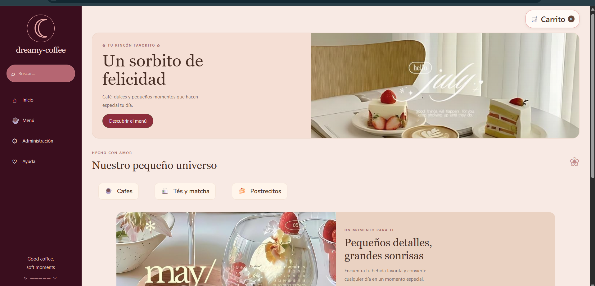
      <br><strong>Diseño anterior</strong>
    </td>
    <td align="center">
      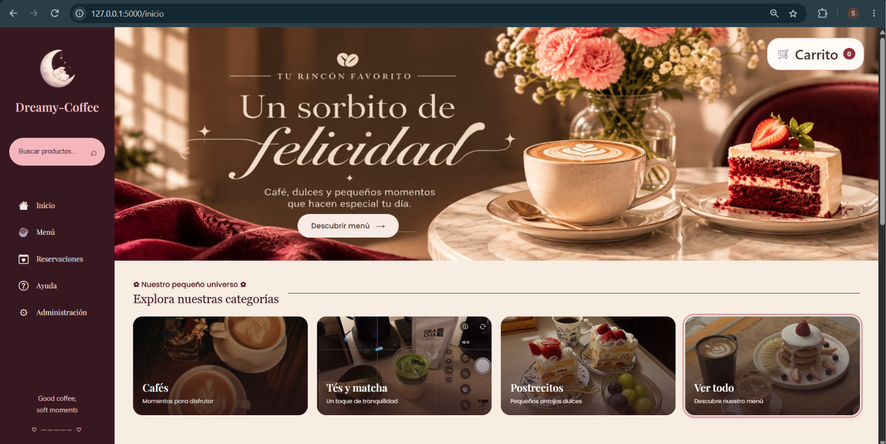
      <br><strong>Diseño actualizado</strong>
    </td>
  </tr>
</table>


### ☕ Menú de productos

<p align="center">
  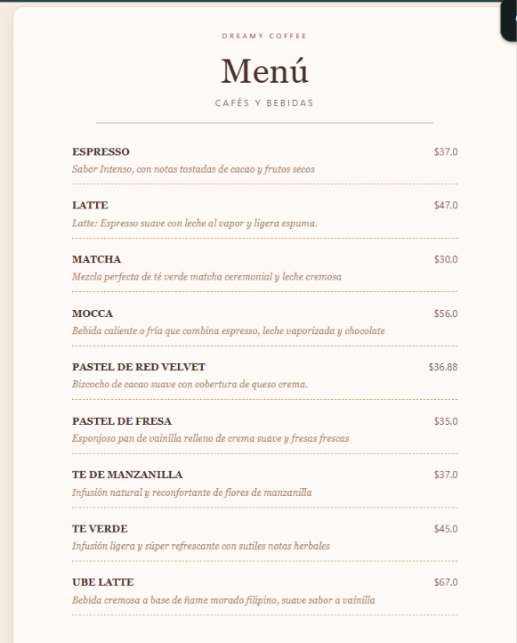
</p>

---

### 🛒 Carrito y realización de pedidos

<table>
  <tr>
    <td align="center">
      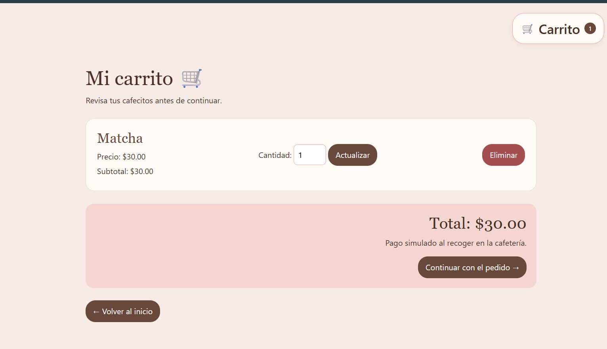
      <br><strong>Carrito de compras</strong>
    </td>
    <td align="center">
      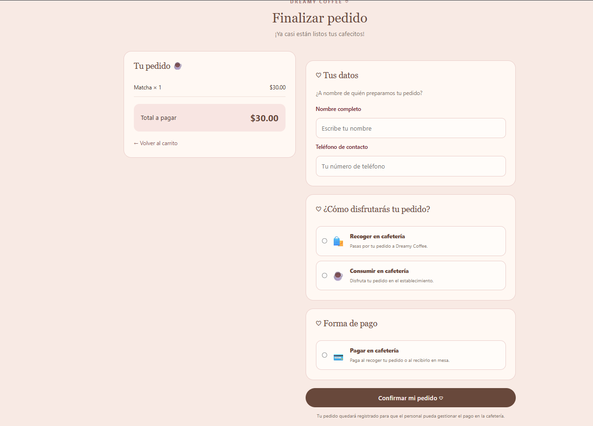
      <br><strong>Finalización del pedido</strong>
    </td>
  </tr>
</table>

---

### ⚙️ Panel de administración

<table>
  <tr>
    <td align="center">
      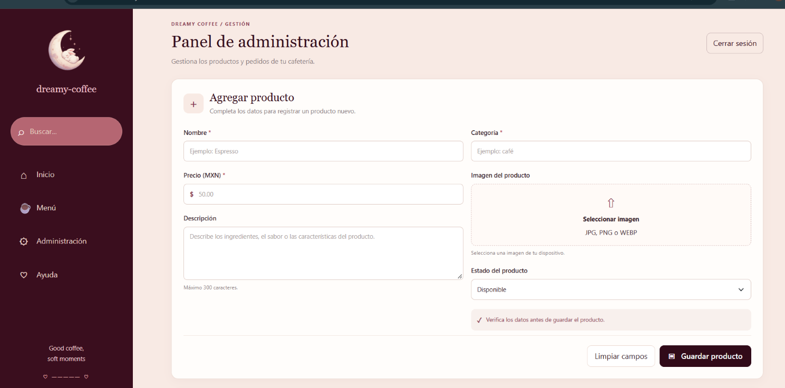
      <br><strong>Agregar productos</strong>
    </td>
    <td align="center">
      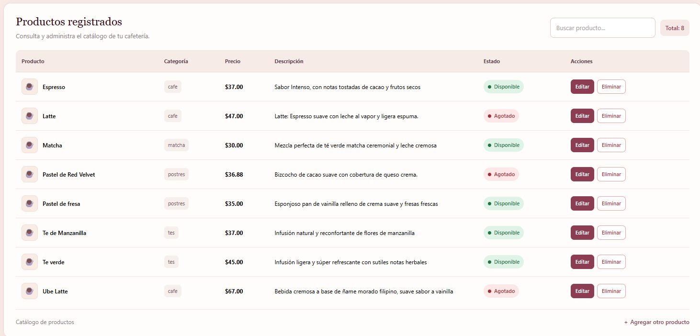
      <br><strong>Productos registrados</strong>
    </td>
  </tr>
  <tr>
    <td align="center">
      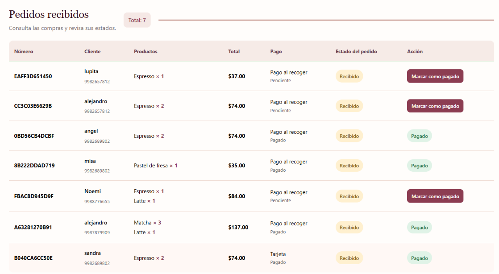
      <br><strong>Pedidos registrados</strong>
    </td>
    <td align="center">
      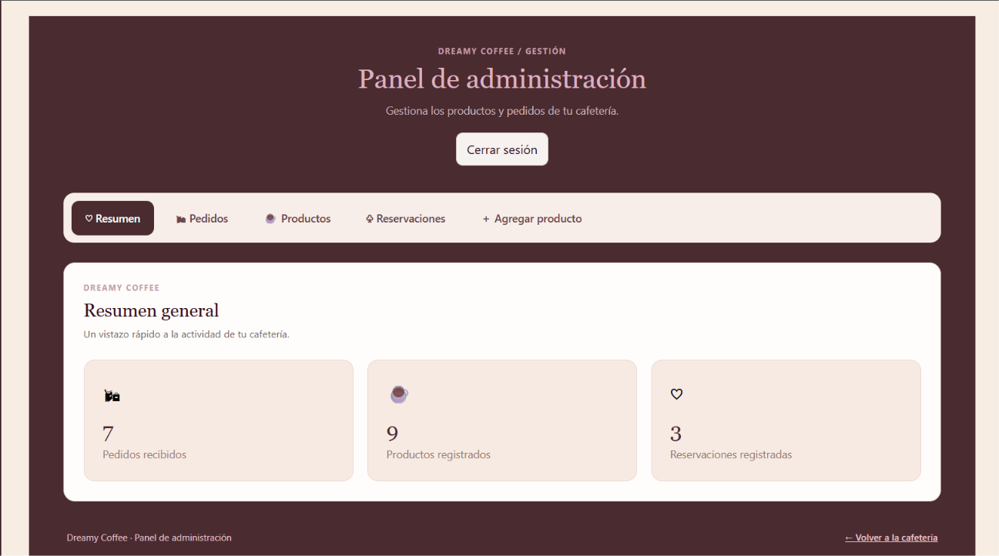
      <br><strong>Versión actualizada</strong>
    </td>
  </tr>
</table>

---

### 📅 Proceso de apartado temporal

<table>
  <tr>
    <td align="center">
      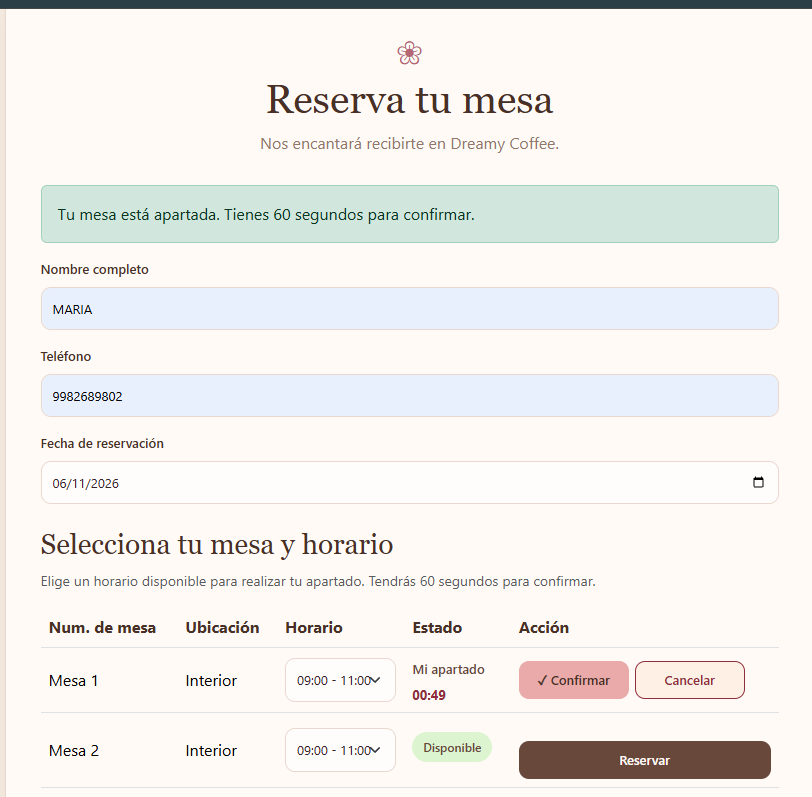
      <br><strong>Reservación temporal</strong>
    </td>
    <td align="center">
      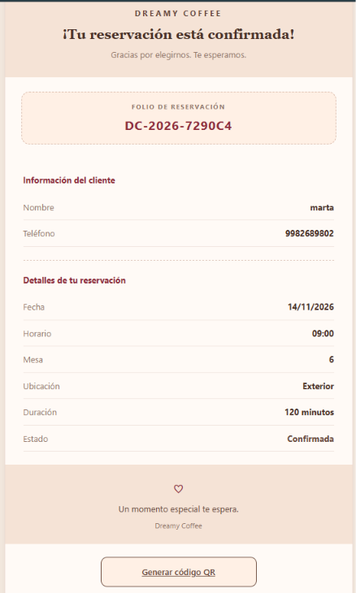
      <br><strong>Confirmación de la reserva</strong>
    </td>
  </tr>
</table>

---

### 📱 Ficha pública y código QR

<p align="center">
  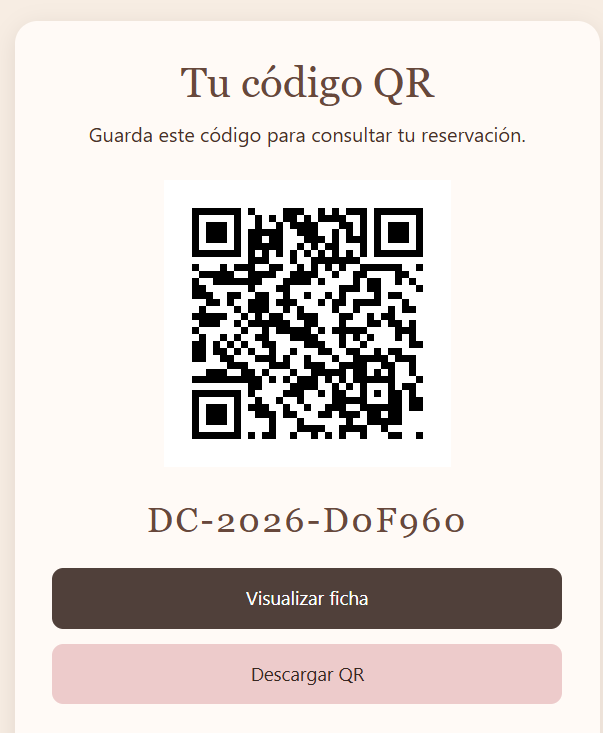
  <br>
  <strong>Código QR de la reservación</strong>
</p>
